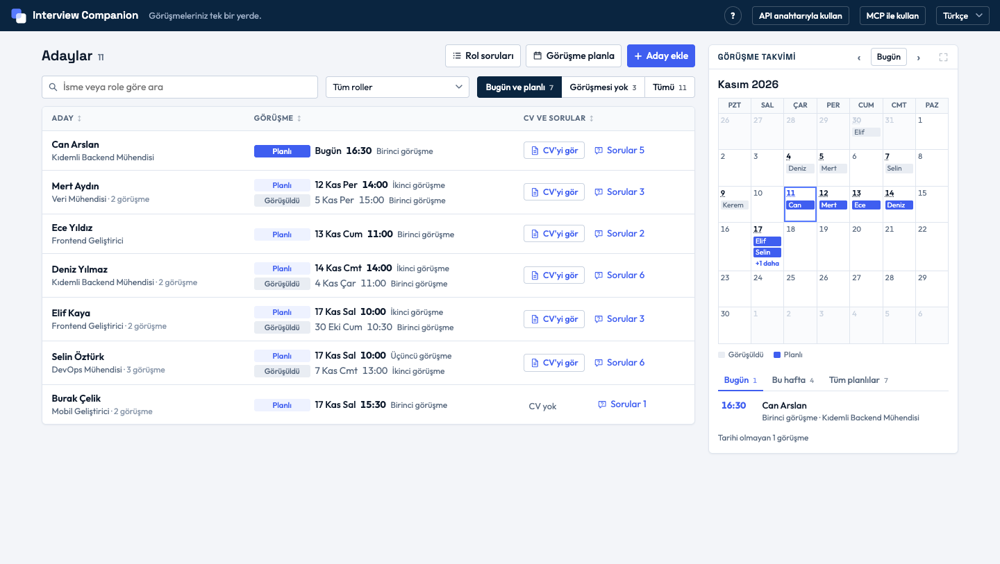
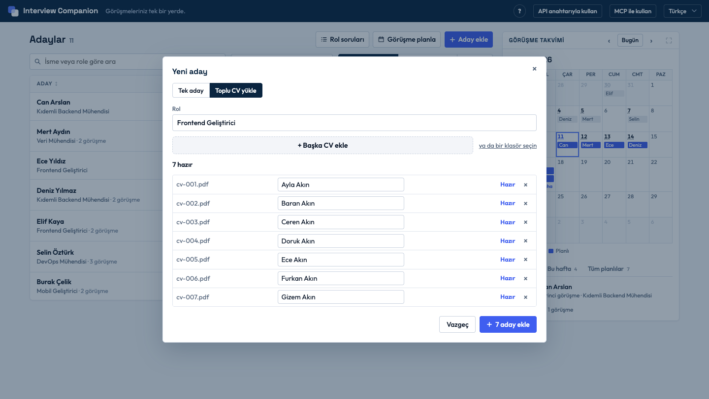
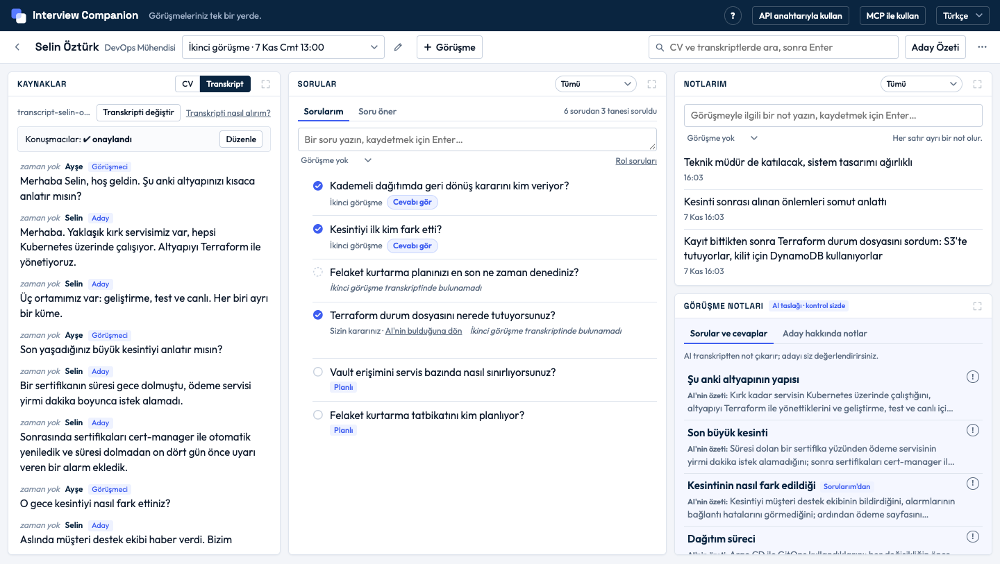
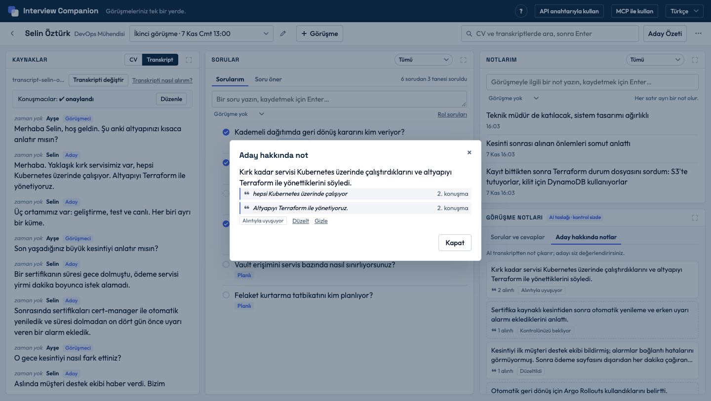
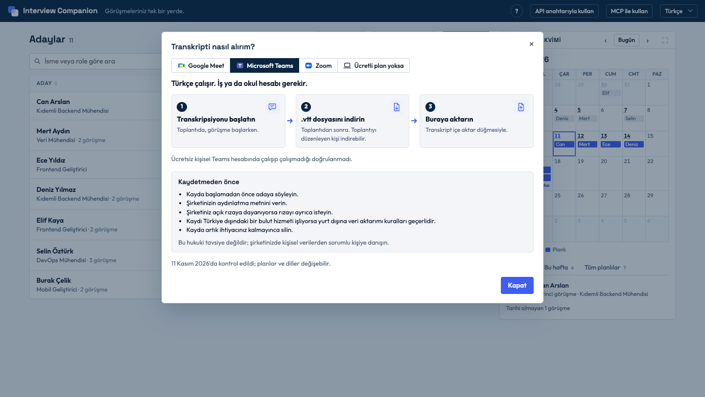

# Interview Companion

[Türkçe](README.tr.md)

Interview Companion keeps everything about a Candidate in one place: the CV, the Interviews, their Transcripts, your notes, and your questions. An AI can take notes from a Transcript for you, and each note comes with the Candidate's exact words, so you can check it in one click. The AI is your note-taker. It does not score anyone, and every decision is yours. The app runs on your own computer, and all of its data stays in one folder there.


*The Candidate list, with today's and this week's Interviews in the calendar.*

All names, CVs, and Transcripts in this repository and its screenshots are fictional. Terms in capitals, such as Candidate or Transcript, are defined in [GLOSSARY.md](GLOSSARY.md).

## What you can do today

### Add Candidates and plan Interviews

- Add one Candidate, or drop many CVs (PDF) at once. The app reads each name from the CV, and you can correct it before saving.
- Give each Candidate a role. Keep a list of Role Questions for a role, and each new Candidate with that role gets a copy.
- Plan Interviews for several Candidates at once: pick a day and a first time, then tick the Candidates.
- See today's and this week's Interviews in a calendar. Order the Candidate list by a column, filter it by role, or show only the Candidates with no Interview yet.


*Many CVs at once: the names come from the CVs.*

### Work on one Candidate

- One screen per Candidate, the Workspace, shows the CV, the Transcript of each Interview, your notes, and your questions side by side.
- Import a Transcript as WebVTT (`.vtt`, which Teams and Zoom produce) or as plain text with `Speaker: text` lines.
- You confirm who is speaking: one Candidate and at least one Interviewer. The AI waits until you have.
- Write your own notes and questions. Each question shows whether it was asked in an Interview, was looked for and not found, or is planned. If you mark it yourself, your mark wins.
- Search the CV and all Transcripts for a word, optionally only in what the Candidate said. Every result is an exact excerpt that opens where it came from.


*One Candidate's Workspace: CV, Transcript, notes, and questions together.*

### Let the AI take notes

- **Interview notes**, in two tabs. **Questions and answers** lists the questions asked in the Interview, each with a short account of the answer. **Notes about the Candidate** lists short notes. Every line carries the quotes it was written from, and the app saves it only if each quote appears word for word in the Transcript.
- You confirm, correct, or dismiss each note, and you can mark a question and its answer as wrong.
- Suggested Questions for the next Interview, which you can copy into your own list.
- A Candidate Brief: one page about the Candidate, with the quotes behind each point.


*Interview notes: each line with the Candidate's own words, ready for you to check.*

### Everything else

- Export a Candidate as a zip file and import it into another copy of the app.
- The interface is in Turkish and English.
- Demo data with eleven fictional Candidates lets you try every screen without any work.

## Two ways to use the AI

1. **With an Anthropic API key.** Save the key in the app. The app calls the model only when you press a button, and it says beforehand what it will send.
2. **Without a key, through Claude Desktop or Claude Code.** Connect it to the app once over MCP, an open standard that lets an AI application use another program's data. Then simply ask, for example: "What did Selin Öztürk say about Terraform?" Claude reads the app's data live, on your computer; nothing is copied or uploaded again. The answer comes with the quote it rests on and where it is from (the CV, or which Interview's Transcript), and it says so when something is written in the CV but was not talked about, or is not there at all. If you allow it, Claude saves the notes it writes into the app, where they are checked like the app's own.

Over MCP, the AI application can read, and, with your permission, save its own notes, questions, and Candidate Brief. It has no tool to delete or change Candidates, Interviews, CVs, Transcripts, or your notes. Setup takes a few minutes: see [docs/mcp.md](docs/mcp.md).

## Getting a Transcript

- Microsoft Teams (work or school account) and Zoom (paid plan) can give a WebVTT file with speaker names, which the app imports.
- Google Meet makes transcripts only in a short list of languages, and Turkish was not on it on 2026-11-11 ([Google's help page](https://support.google.com/meet/answer/12849897)).
- Otherwise, record the call with the Candidate's consent and turn the recording into text with a speech-to-text tool on your computer.

The app has a guide for this, **How do I get a Transcript?**, next to the Transcript import. Its facts and sources are in [docs/research/getting-a-transcript.md](docs/research/getting-a-transcript.md).


*The guide in the app: the way to a Transcript for each meeting tool.*

## Run it

You need [Node.js](https://nodejs.org) 24 or later and git. No API key is needed.

```sh
git clone https://github.com/GDenizKaratas/interview-companion.git
cd interview-companion
npm install
npm run demo     # optional: loads the eleven fictional demo Candidates
npm start
```

Then open http://localhost:3000. The interface starts in Turkish; the language menu at the top right switches it to English. Running `npm run demo` again gives a fresh demo set and leaves your other Candidates alone.

The data is in the `data/` folder inside the project: one SQLite file and the CV files. Set `DATA_DIR` to use another folder. The app listens only on your own computer (`127.0.0.1`) and has no login.

## What it deliberately does not do

- It does not score, rank, or compare Candidates.
- The AI decides nothing. It writes notes; you read the quotes and judge.
- It has no cloud account. There is no sign-up and no server of ours; a model is called only when you ask, with your own key or your own Claude application.
- It does not record or join meetings. You bring the Transcript.

## Before you use real data

Interview data is personal data. Before you add a real Candidate, check that the Candidate agreed to the recording and to AI processing, that your organization allows this data on your computer, and that your AI provider is approved for it. With an API key the data goes to Anthropic; over MCP it goes to the model your Claude application uses. The app does not encrypt its data folder, so use an encrypted disk, and delete a Candidate when you no longer need their data.

## What could come next

Ideas, not promises. The reasoning and sources are in [docs/research/what-could-come-next.md](docs/research/what-could-come-next.md).

| Idea | What it would give | What it needs |
|---|---|---|
| Calendar file (`.ics`) for Planned Interviews | Planned Interviews in Google Calendar or Outlook with one import | A file export; no account or permission |
| Paste a Transcript; read `.srt` and `.docx` | Fewer steps from a meeting tool or a speech-to-text tool | Two more readers and a text box |
| Speech-to-text on the computer for a recording | A Transcript when no meeting tool gives one, with the voice staying on the computer | A local model such as Whisper and a way to tell speakers apart; quality on Turkish is untested |
| Print or PDF of a Candidate Brief | A brief to bring to a meeting | A print layout |
| CSV import of Candidates | Many Candidates from a spreadsheet or an applicant tracking system | A column mapping and checks |
| Heavy: fetch Transcripts automatically from Google Meet, Teams, or Zoom | No file to download | Meet has no Turkish transcripts. Before other people can connect, each vendor has its own review: Google's verification for sensitive data, a Microsoft administrator's permission, Zoom Marketplace review. Their "transcript ready" messages are made for a server on the internet, not for an app on your computer. |
| Heavy: live Google Calendar sync | Interviews appear and update by themselves | The same Google verification; the `.ics` file gives most of the value |
| Heavy: one database shared by several people over a network drive | A team working on the same Candidates | SQLite advises against a database file on a network drive; this needs a real server with accounts and permissions |

## For developers

One TypeScript project with three modules: `core` holds every rule and all data access; `web` (a local server and the browser interface) and `mcp` (the MCP server) only call `core`. Run `npm test`, `npm run typecheck`, and `npm run lint`. More in [docs/architecture.md](docs/architecture.md), [docs/decisions.md](docs/decisions.md), [docs/adr](docs/adr), [docs/mcp.md](docs/mcp.md), and [CONTRIBUTING.md](CONTRIBUTING.md). License: [MIT](LICENSE).
