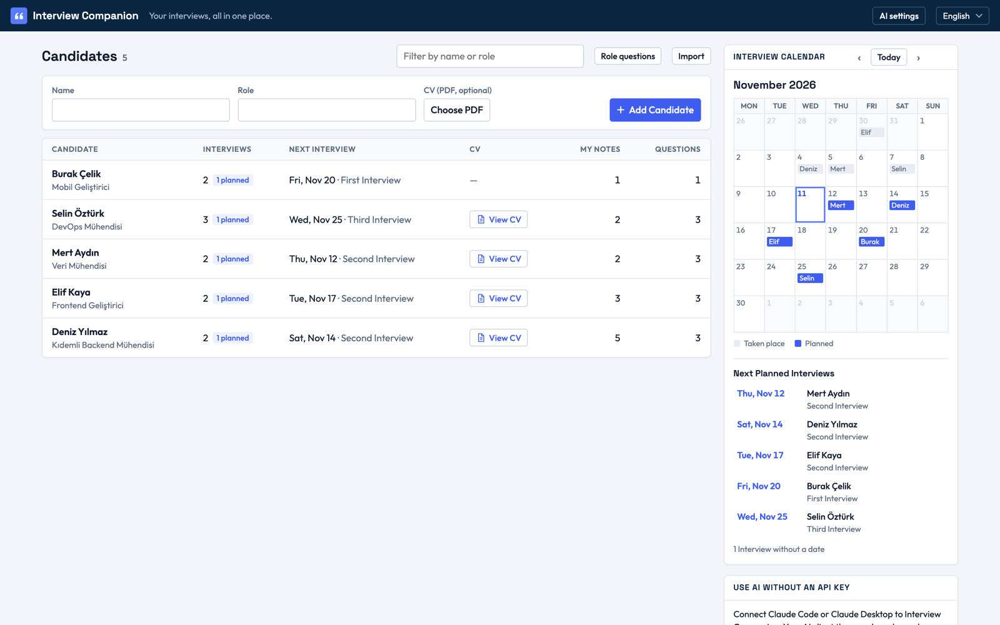
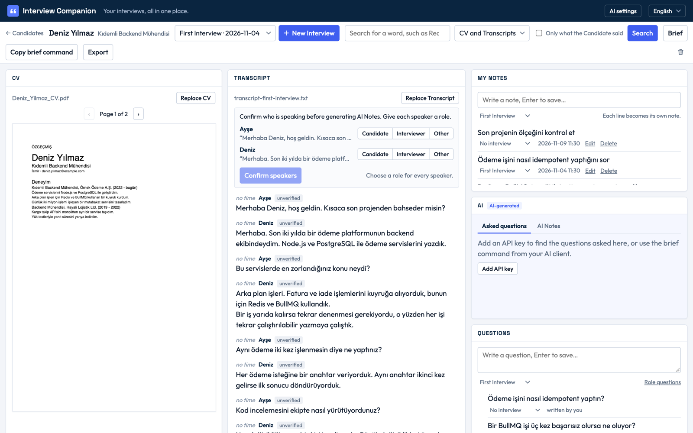
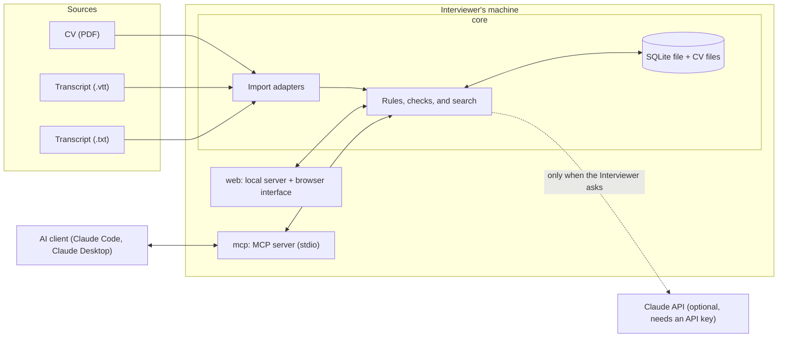

# Interview Companion

A local workspace for technical interviewers. It keeps a Candidate's CV, Interview Transcripts, your own notes, and your questions in one place, and helps you find what the Candidate actually said. AI can help, but every quote it gives is checked against the CV or Transcript it cites, and it never judges the Candidate.


All names, CVs, and Transcripts in this repository and its screenshots are fictional. Terms in capitals, such as Candidate or Speaker Mapping, are defined in [GLOSSARY.md](GLOSSARY.md).

## The problem

An interviewer who talks to many Candidates ends up with CVs in one folder, Transcripts in another, notes in a third place, and questions in their head. Before a second Interview, they need to know what this Candidate already said about a topic, and what they have not been asked yet. Asking a general chatbot is risky: it can mix up who said what, invent a quote, or hand out a verdict on a person.

Interview Companion keeps everything about one Candidate on one screen, finds exact excerpts, and lets AI help only in ways that can be checked.

## How it works

1. **Add a Candidate**, optionally from their CV (a PDF with text). The app reads the text page by page and suggests the name.
2. **Add Interviews.** An Interview can have a date and a time. One that has not happened yet is Planned and shows in the calendar.
3. **Write notes and questions** while you prepare or listen. Each line you paste becomes its own note. Questions you ask every Candidate for a role can be kept as Role Questions and are copied to each new Candidate with that role.
4. **Import the Transcript** after the Interview: WebVTT (`.vtt`, for example a Microsoft Teams transcript download) or plain text with `Speaker: text` lines.
5. **Confirm who is speaking.** Every speaker starts unverified. You mark each one as Candidate, Interviewer, or Other. AI Notes and Asked Questions wait for this, and Suggested Questions leave out a Transcript until it is confirmed.
6. **Search** the CV and Transcripts for a word, for example "Redis", optionally only in what the Candidate said. Results are exact excerpts, and a click opens the place they come from.
7. **Get AI help, if you want it**: AI Notes about an Interview, the Asked Questions with a short Answer Summary each, Suggested Questions for the next Interview, and a Candidate Brief. See [Two ways to use AI](#two-ways-to-use-ai).
8. **Review.** Each AI Note can be confirmed, corrected, or dismissed. Accepting a Suggested Question copies it into your own list.

You can also export a Candidate as a zip file and import it on another copy of the app.



## Quick start

You need [Node.js](https://nodejs.org) 24 or later and git. No API key is needed.

```sh
git clone https://github.com/GDenizKaratas/interview-companion.git
cd interview-companion
npm install
npm start
```

Open http://localhost:3000. On the first start the app loads one fictional demo Candidate, Deniz Yılmaz, with a CV and a First Interview whose Transcript is not confirmed yet.

To load the full demo set, stop the app with Ctrl+C, then run:

```sh
npm run demo
npm start
```

This adds four more fictional Candidates. Elif Kaya, Mert Aydın, and Selin Öztürk each have a past Interview with a confirmed Transcript, AI Notes, and Asked Questions, so you can see the review screens without an API key. Running `npm run demo` again replaces the demo set with a fresh copy and leaves your other Candidates alone.

The interface is in Turkish by default. Switch to English with the language menu at the top right.

### A short walkthrough with the demo

1. Open **Deniz Yılmaz** and choose **First Interview** in the bar. The Transcript shows two speakers, Ayşe and Deniz, both unverified.
2. Mark Deniz as **Candidate** and Ayşe as **Interviewer**, then **Confirm speakers**.
3. Type `Redis` in the search box, tick **Only what the Candidate said**, and search. You get the CV lines and Deniz's segment, and nothing Ayşe said.
4. Open **Elif Kaya** and choose **First Interview**. The AI panel shows the Asked Questions with their Answer Summaries; the **AI Notes** tab shows notes with their quotes. Confirm, correct, or dismiss one.
5. In the Questions panel, a Saved Question that was asked shows where; one that was not shows "Not found".



### Where your data is

Everything is stored on your machine in `data/` inside the project folder: one SQLite file and a folder of CV files. Set `DATA_DIR` to use another folder. The web server listens only on `127.0.0.1`. Deleting a Candidate (it asks first) removes everything about them, including the CV file.

### Commands

| Command | What it does |
|---|---|
| `npm start` | Builds the interface and starts the app at http://localhost:3000 (`PORT` changes the port). |
| `npm run dev` | Starts the server and the interface with reload on change, for development. |
| `npm run demo` | Loads the fictional demo set. |
| `npm run mcp` | Starts the MCP server on stdio. An AI client normally starts it for you; see [docs/mcp.md](docs/mcp.md). |
| `npm test` | Runs the automated tests. |
| `npm run typecheck`, `npm run lint` | Type checks and lints the code. |
| `npm run evaluate` | Runs the real-model evaluation (needs `ANTHROPIC_API_KEY`, calls the paid API). |

## Core principles

- **Evidence is only an exact excerpt from a CV or a Transcript.** Your own notes are never Evidence of what the Candidate said ([ADR 0003](docs/adr/0003-evidence-is-only-cv-and-transcript.md)).
- **No AI Notes or Asked Questions before the speakers are confirmed.** Your AI client can still read an unconfirmed Transcript, where every speaker is marked unconfirmed. The worst failure of this product is crediting the Interviewer's words to the Candidate, and a name in a file is a label, not an identity ([ADR 0004](docs/adr/0004-speaker-mapping-gate.md)).
- **No verdicts.** No scores, rankings, hire or no-hire, and no comparing Candidates. AI describes what was said; the judgment stays with you.
- **Nothing runs without a request.** The app calls a model only when you press a button for it.
- **AI never changes your work.** It cannot edit your notes or Saved Questions. AI Notes you reviewed and suggestions you accepted stay when AI output is generated again.
- **Local, one Interviewer.** One Interviewer, one machine, one SQLite file, no accounts ([ADR 0001](docs/adr/0001-local-single-user-sqlite.md)).

## Two ways to use AI

| | In the app, with an API key | Through your AI client (MCP), no key |
|---|---|---|
| Who calls the model | The app, with your Anthropic API key, saved in AI Settings | Your AI client, such as Claude Code or Claude Desktop, with its own model |
| What you get | AI Notes, Asked Questions, Suggested Questions | A Candidate Brief, and, if you allow saving, AI Notes, Asked Questions, and Suggested Questions |
| Where quotes are checked | Before anything is saved | AI Notes, Asked Questions, and Suggested Questions: before they are saved, when saving is on. The Candidate Brief: saved as written, and its quotes are marked found or not found each time it is read. |

The app's model is Claude, behind a narrow provider interface; the model and its settings are in `src/core/claude-provider.ts`. Before each request the app says what will be sent, for example "Sends this Interview's Transcript with speaker roles to Claude (Anthropic). Not the CV or your notes."

The AI client route needs no key in the app: the Workspace has a **Copy brief command** button, and you paste the command into Claude Code. With another AI client, such as Claude Desktop, use the server's `brief` prompt in the way that client offers prompts. Saving from the AI client is off until you turn it on in AI Settings ([ADR 0002](docs/adr/0002-two-ai-modes.md), [ADR 0005](docs/adr/0005-ai-client-saves-through-core.md)). Setup for Claude Code and Claude Desktop is in [docs/mcp.md](docs/mcp.md).

## Why MCP?

The Model Context Protocol (MCP) is an open standard that lets an AI client use a program's data through tools the program describes. Interview Companion runs an MCP server over stdio, so there is no network port: only the AI client that started it can talk to it.

It matters here because many interviewers already use an AI client and do not want to manage another API key. With MCP, the app needs no key and calls no model; your AI client brings the model, discovers the tools (`search_evidence`, `get_transcript`, `get_cv`, and others) and the `brief` prompt at run time, and decides when to call them. A plain web API could serve the same data. But someone would still have to write code, for each AI application, that describes the API to the model. The tools can read everything, but they can only write checked AI work, and only when you allow it. They can never change your notes, questions, CVs, or Transcripts.

[docs/mcp.md](docs/mcp.md) explains MCP, tools, and prompts in more depth, lists every tool, and shows how to try it with the demo data.

## Architecture

One TypeScript project with three parts:

- **core** holds every rule and all data access (Node's built-in SQLite).
- **web** is a local server (Hono) and a browser interface (React). It only calls core.
- **mcp** is the MCP server. It only calls core, through a view that holds core's reads and the checked AI saves.

Because web and mcp only call core, each rule, such as "no AI Notes before the Speaker Mapping is confirmed", is written once.



More detail: [architecture](docs/architecture.md), [decision log](docs/decisions.md), [ADRs](docs/adr), [Workspace wireframe](docs/workspace-wireframe.md).

## Trust and safety

What the code guarantees:

- **Every AI quote is checked.** An AI Note, Asked Question, or Suggested Question is saved only if each of its quotes appears word for word in the CV page or Transcript segment it cites. One bad quote drops the whole item.
- **Quotes come from the right person.** An AI Note or an Answer Summary may quote only the Candidate's segments; an Asked Question is quoted from the Interviewer's.
- **Changing the speakers marks AI output Stale.** Notes and Asked Questions made from an older Speaker Mapping stay visible but are marked as not trusted until generated again.
- **The Candidate Brief's quotes are checked every time it is read**, so a quote from a replaced Transcript shows as not found.
- **The MCP server cannot change your data**, except for checked AI work while saving is on, and it cannot turn saving on itself.
- **Transcripts and CVs are treated as data, not instructions.** The prompts say so, and the quote check does not depend on the model obeying.

What the code does not guarantee:

- **That a statement follows from its quote.** A quote can be real and the statement about it still wrong or one-sided. That is why AI Notes start Unreviewed and the screen shows the quote next to each one.
- **The content of a Candidate Brief.** It is written by your AI client's model. Only its quotes are checked, and only once it is saved in the app.
- **That an Answer Summary is complete.** It describes what was said; it does not say whether the answer was right.

## Before you use real data

Interview data is personal data about people who did not choose this tool. Settle these questions before you put a real Candidate in it:

- **Consent.** Did the Candidate agree to the Interview being recorded and transcribed, and to the Transcript being processed with AI? Did the other people in the Transcript, such as other interviewers?
- **Your organization's rules.** Are you allowed to keep candidate data on your own computer, outside the recruiting system? For how long?
- **The AI provider.** In-app AI sends data to Anthropic: the Transcript for AI Notes, the Transcript and your Saved Questions for Asked Questions, and the CV, confirmed Transcripts, your notes, and your Saved Questions for Suggested Questions. The app shows what is sent next to each button. Through MCP, data goes to whichever model your AI client uses. Is that provider approved for candidate data, under an agreement your organization accepts?
- **The law that applies to you**, such as the GDPR or KVKK: what is your legal basis, and how do you answer a Candidate who asks to see or delete their data? Deleting a Candidate in the app removes their rows and files, but not copies you exported or sent elsewhere.
- **Retention.** When do you delete a Candidate after the hiring decision?
- **Your machine.** Is the disk encrypted? The data folder is not encrypted by the app, and the API key is stored in the same SQLite file in plain text.
- **Other programs.** The local web interface has no login. Any program on your computer that can reach `127.0.0.1` can read and change the data, including an AI client with shell access.
- **Exports.** A Candidate export is a zip with the CV, Transcripts, and everything else about them. Share it only where the Candidate's consent allows.
- **No decisions by AI.** Do not use AI output as the basis of a hiring decision on its own. Read the Evidence.

## Testing

```sh
npm test            # the automated tests
npm run typecheck
npm run lint
```

Tests go through core's public interface against a real temporary SQLite file, so they check behavior, not internals. AI tests use a fake provider; MCP tests use the MCP SDK's in-memory client. The interface has no automated tests.

How the real model behaves is a separate question, answered by a hand-run evaluation on fictional scenarios (`npm run evaluate`). Its results are written to [docs/evaluation](docs/evaluation/README.md) with the date and model, never mixed with the test results. No run has been recorded yet, so this README states no numbers about the model.

## Limitations

- **One Interviewer, one machine.** No accounts, no sharing, no sync.
- **Keyword search only.** A search for "caching" will not find "Redis". It handles Turkish letters and suffixes, so "Redis" also finds "Redis'i".
- **Correct notes without an exact quote are lost.** The quote check drops them to keep the Evidence guarantee.
- **CVs must be PDFs with text.** A scanned CV without a text layer is refused.
- **Transcripts are imported from files.** WebVTT and plain text only. No recording, live transcription, or meeting bots. Google Meet makes no caption file, and its transcript, a Google Doc, is not supported yet ([#33](https://github.com/GDenizKaratas/interview-companion/issues/33)).
- **Speakers are assigned by hand**, once per Transcript.
- **One model provider** (Claude) for in-app AI.

## Roadmap

These are options, not promises, in rough order:

1. The first recorded real-model evaluation run ([#62](https://github.com/GDenizKaratas/interview-companion/issues/62)).
2. A Google Meet plain-text transcript adapter ([#33](https://github.com/GDenizKaratas/interview-companion/issues/33)).
3. A second model provider.
4. MCP tools to add an Interviewer Note or save a question.
5. A side-by-side view of what several Candidates said on one topic, with no ranking.
6. Transcript import straight from Google Meet, Zoom, or Teams.
7. Semantic search.

## Contributing

See [CONTRIBUTING.md](CONTRIBUTING.md).

## License

[MIT](LICENSE)
