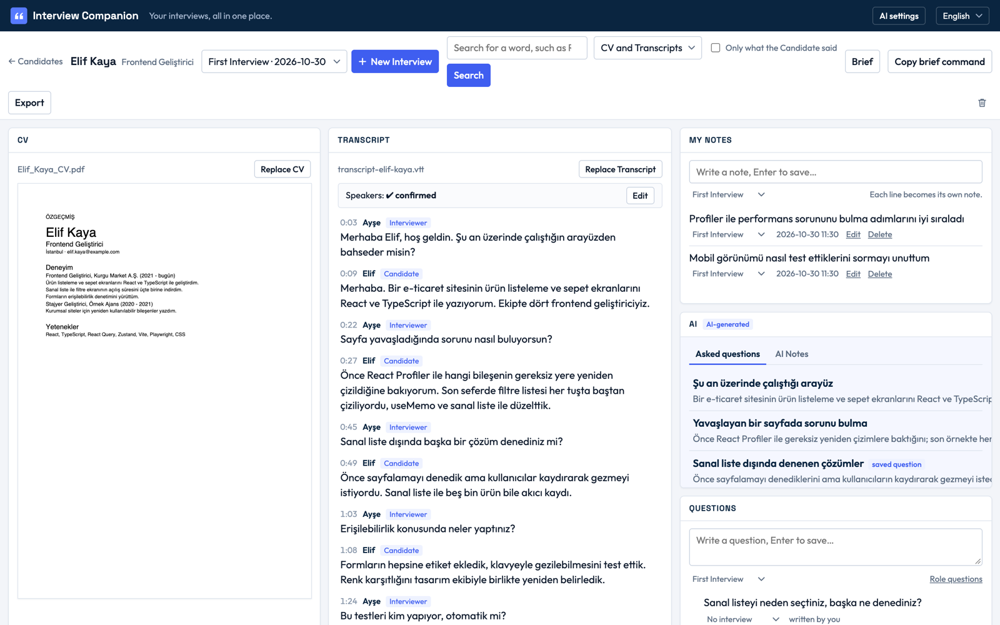
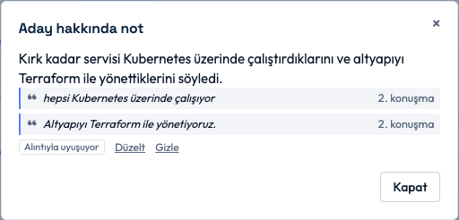
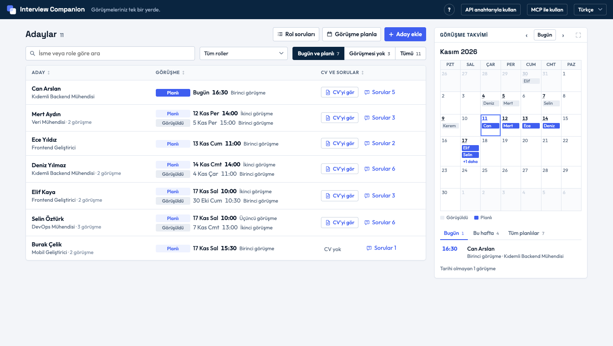
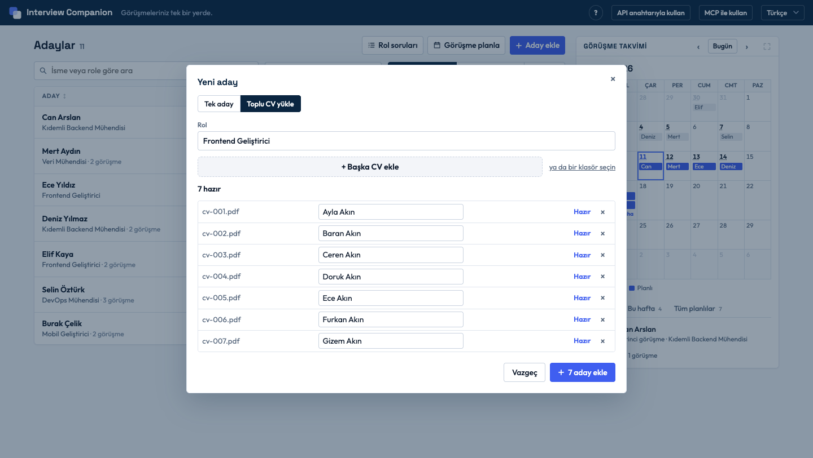
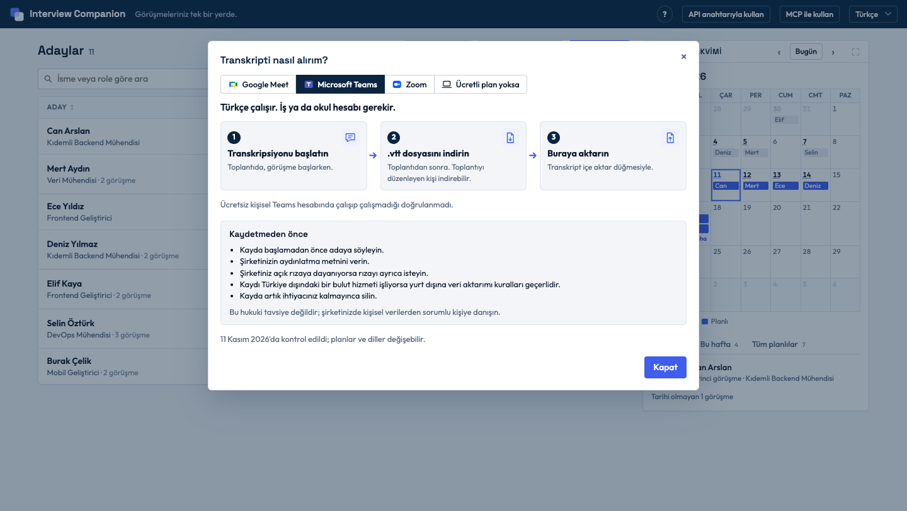

# Interview Companion

[English](README.md)

**Görüşmeleriniz tek bir yerde.** Interview Companion sayesinde her adayın CV'sini, görüşme transkriptlerini, notlarınızı ve sorularınızı tek ekranda toplayabilirsiniz; transkriptten notları da AI sizin için çıkarır. Böylece görüşme sırasında not yetiştirmeye çalışmanız, sonrasında da kayıtlarda "Aday bunu söylemiş miydi?" diye aramanız gerekmez.

- **AI yorum katmaz, özetler.** Her notunu adayın görüşmede söylediklerine ya da CV'sine dayandırır ve alıntısını yanında gösterir. Alıntı transkriptte kelimesi kelimesine geçmiyorsa uygulama o notu kaydetmez. Alıntı, adayın bunu söylediğini gösterir; söylediğinin doğru olduğunu değil.
- **Kararı siz verirsiniz.** AI not tutar; kimseye puan vermez, kimseyi sıralamaz, kimse hakkında karar vermez.
- **Veriniz bilgisayarınızda kalır.** Uygulamayı kendi bilgisayarınızda çalıştırırsınız; hesap açmanız gerekmez. Ücretsiz ve açık kaynaklıdır.


*Bir adayın çalışma alanı. Uygulama İngilizce de kullanılabilir. Buradaki bütün adlar ve transkriptler kurgudur.*

## Kurulum ve deneme

[Node.js](https://nodejs.org) 24 ya da daha yenisi ve git gerekir. Yalnızca macOS'ta denendi. Terminale alışık değilseniz bu kurulumu bir kez teknik bir arkadaşınızdan rica edebilirsiniz.

```sh
git clone https://github.com/GDenizKaratas/interview-companion.git
cd interview-companion
npm install
npm run demo     # isteğe bağlı: denemek için on bir kurgu aday
npm start
```

Sonra tarayıcıda http://localhost:3000 adresini açmanız yeterli. Dili sağ üstten değiştirebilirsiniz. Notların ve soruların her durumunu görmek için **Selin Öztürk**'ü açabilirsiniz. `npm run demo` komutunu yeniden çalıştırırsanız yalnızca örnek adaylar tazelenir; kendi adaylarınıza dokunulmaz.

## Nasıl çalışır

Uygulamadaki **?** düğmesi de aynı altı adımı gösterir.

1. **Aday ekle.** İsim ve rol yeter. **Toplu CV yükle** ile birden çok CV eklerseniz isimler CV'lerden okunur.
2. **CV yükle.** Metin içeren bir PDF.
3. **Görüşme ekle.** Tarihi ve saatiyle; takvimde görünür.
4. **Transkripti yükle.** Görüşmeden sonra, toplantının metni. Teams ve Zoom bu metni oluşturabilir, Google Meet ise bir eklentiyle; nasıl alınacağını uygulamadaki **Transkripti nasıl alırım?** rehberi anlatır.
5. **Konuşmacıları onayla.** Aday kim, görüşmeci kim? Siz onaylayana kadar AI bekler.
6. **Notları kontrol et.** Alıntıyla uyuşan notu onaylayabilir, uyuşmayanı düzeltebilir ya da gizleyebilirsiniz.



Bunlara ek olarak her role **Rol soruları** tanımlayabilirsiniz; o role eklenen her aday bunları alır. **Sorularım**'da hangilerinin sorulduğunu görebilirsiniz. CV'de ve bütün transkriptlerde arama yapabilir, **Soru öner** ile sonraki görüşme için soru alabilirsiniz. Bir adayı **Dışa aktar** ile başka bir bilgisayara taşıyabilirsiniz.

## AI'yi kullanmanın iki yolu

Uygulamanın geri kalanı AI olmadan da çalışır.

| | API anahtarıyla | Claude Desktop ya da Claude Code ile (MCP) |
|---|---|---|
| Ne gerekir | Anthropic API anahtarı (kullandıkça ücretli) | Claude Desktop ya da Claude Code; API anahtarı gerekmez |
| Nasıl kullanılır | Çalışma alanında bir düğmeye basarsınız | Claude sohbetinde sormanız yeterli: "Interview Companion'ı başlat ve Selin Öztürk'ün Terraform hakkında ne dediğini söyle." |
| Bilgisayarınızdan ne çıkar | Düğmenin yanında yazan veri, Anthropic'e | Claude'un okuduğu veri, Claude'un kullandığı modele |
| Sonuç nerede görünür | Görüşme notları kartında | Sohbette; **Buraya kaydetmeye izin ver** açıksa uygulamada da |

MCP ile Claude, uygulamanın verisine yalnızca sizin başlattığınız sohbette ulaşır. Her cevabında alıntıyı ve alıntının nereden geldiğini gösterir. Yalnızca kendi notlarını, sorularını ve Aday Özeti'ni kaydedebilir; bunlar, uygulamada AI'yi yeniden çalıştırınca olduğu gibi önceki AI çıktısının yerini alır. Adayları, CV'leri, transkriptleri, notlarınızı ve sorularınızı silemez ya da değiştiremez. Bağlamak için uygulamada **MCP ile kullan**'a basmanız yeterli; ayrıntılar [docs/mcp.md](docs/mcp.md) dosyasında (İngilizce).

## Gerçek veri girmeden önce

Görüşme verisi kişisel veridir. Gerçek bir aday eklemeden önce şunlardan emin olun:

- aday, kayda ve verisinin AI ile işlenmesine onay verdi,
- kurumunuz bu verinin bilgisayarınızda tutulmasına izin veriyor,
- kullandığınız AI sağlayıcısı bu veri için onaylı.

Uygulama verisini şifrelemez. Şifreli bir disk kullanmanızı ve işiniz biten adayı silmenizi öneririz. Türkiye'de 6698 sayılı Kişisel Verilerin Korunması Kanunu (KVKK) uygulanır. Bu bir hukuki görüş değildir; kurumunuzda kişisel verilerden sorumlu kişiye danışın.

Veriniz proje klasöründe değil, bilgisayarınızın uygulama verisi klasöründe durur; uygulama açılırken bu klasörün yolunu yazar. Proje klasörünü silmek verinizi silmez. Yedek almak isterseniz uygulama kapalıyken bu klasörü kopyalayabilir ya da adayı **Dışa aktar** ile kaydedebilirsiniz.

## Ne yapmaz

- Adaylara puan vermez, onları sıralamaz ya da karşılaştırmaz; AI hiçbir karar vermez.
- Toplantıya katılmaz, kayıt almaz. Transkripti siz getirirsiniz.
- Bulut hesabı yoktur. AI yalnızca siz istediğinizde çalışır.

<details>
<summary>Daha fazla ekran görüntüsü</summary>


*Adaylar ve Görüşme takvimi: bugün kiminle görüşeceğiniz ilk bakışta.*


*Toplu CV yükle: isimleri tek tek yazmazsınız.*


*Transkripti nasıl alırım? rehberi: her toplantı aracında transkriptin nasıl alınacağı ve kayıttan önce yapılacaklar.*

</details>

## Yol haritası

Bunlar plan, söz değil. Gerekçeler ve kaynaklar [docs/research/what-could-come-next.md](docs/research/what-could-come-next.md) dosyasında (İngilizce).

**Sırada**

- Planlanan görüşmeler için takvim dosyası (`.ics`), Google Takvim'e ya da Outlook'a aktarmak için.
- Transkripti yapıştırma; `.srt` ve `.docx` dosyalarını okuma.
- Aday Özeti'ni yazdırma ya da PDF olarak kaydetme.
- Adayları bir tablodan (CSV) içe aktarma.

**Daha çok iş ister**

- Görüşmeyi uygulamanın içinde kaydedip Türkçe yazıya dökme; ses bilgisayardan çıkmadan.
- Transkriptleri Teams'ten ya da Zoom'dan kendiliğinden çekme.
- Google Takvim ile canlı eşitleme.
- Bir ekibin aynı adaylar üzerinde birlikte çalışması.

## Geliştiriciler için

Üç modüllü tek bir TypeScript projesi: `core` bütün kuralları ve veri erişimini tutar; `web` ve `mcp` yalnızca `core`'u çağırır. Veri, bir SQLite dosyası ve CV dosyalarından oluşur; klasörü `src/core/data-folder.ts` seçer (`DATA_DIR` ile değiştirilir, `PORT` ile port); proje klasöründe `data/interview-companion.sqlite` zaten olan bir kopya onu kullanmaya devam eder. Uygulama yalnızca `127.0.0.1` üzerinden dinler. Denetim için `npm test`, `npm run typecheck` ve `npm run lint` komutlarını çalıştırın. Terimler: [GLOSSARY.md](GLOSSARY.md). Ayrıntılar (İngilizce): [docs/architecture.md](docs/architecture.md), [docs/decisions.md](docs/decisions.md), [docs/mcp.md](docs/mcp.md), [CONTRIBUTING.md](CONTRIBUTING.md). Lisans: [MIT](LICENSE).
