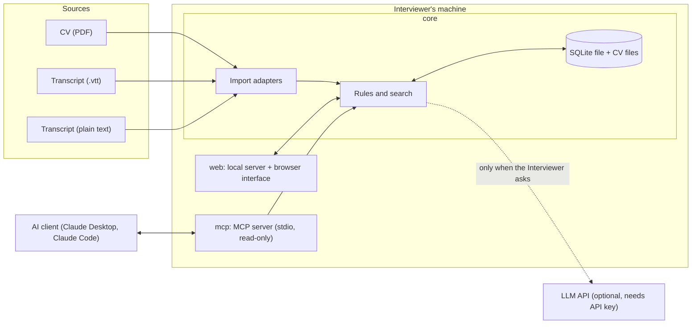
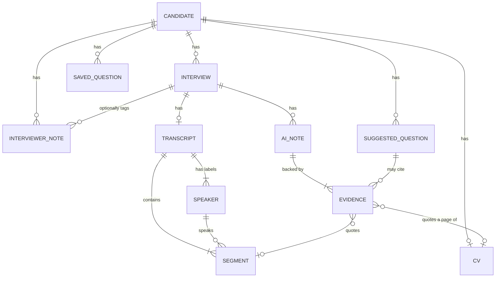

# Architecture

Status: **planned**. Only the project skeleton is implemented: the three modules, the database, creating and listing Candidates, adding Interviews to a Candidate, the interface language, Saved Questions, the CV (upload, text per page, viewing, and the name guess), and Transcript import through adapters (plain text and WebVTT).

Terms in capitals are defined in [GLOSSARY.md](../GLOSSARY.md). Reasons for each choice are in the [decision log](decisions.md).

## Overview

Interview Companion is one TypeScript project that runs on the Interviewer's machine. It has three parts:

- **core** holds every rule and all data access. It knows nothing about the browser or MCP.
- **web** is a local server and a browser interface. It calls core.
- **mcp** is an MCP server. It calls the same core.

Because web and mcp only call core, a rule such as "no AI Notes before the Speaker Mapping is confirmed" exists in one place.

## Two separate integration problems

- **Import adapters** solve "transcripts come in different formats". Each adapter turns one format into the same internal Transcript. A missing field, such as a timestamp, is stored as missing, never invented.
- **MCP** solves "an AI client wants to read this data". It has nothing to do with where a Transcript came from.

## Domain model

Notes on the model:

- A **Speaker** is a label from the file plus a role (Candidate, Interviewer, Other, or not yet assigned). The Speaker Mapping is confirmed once per Transcript.
- **Evidence** stores the exact quote and where it is: a Transcript segment, or a CV page.
- An **AI Note** has a Review State and a Stale flag. A Corrected note keeps the original AI text.
- A **Saved Question** is a copy. It does not point back to a Suggested Question that could later disappear.

## Main flows

**Import a CV.** The PDF is saved, its text is extracted per page and indexed for search. A PDF with no text is refused with a clear message.

**Import a Transcript.** An adapter parses the file into segments and speaker labels. All speakers start unverified. The Interviewer assigns roles and confirms.

**Search.** A query runs against CV pages, Transcript segments, or both. Results are exact excerpts with their location. No match means "nothing found in the indexed sources", not "the Candidate lacks this".

**Generate AI Notes (in-app mode).** Requires an API key and a confirmed Speaker Mapping. Core sends the Transcript segments with their roles to the model and asks for statements with quotes. Core then checks each quote against the source and saves only the notes that pass, as Unreviewed.

**Suggest questions (in-app mode).** Runs only on request. Core sends the CV, earlier Transcripts, Interviewer Notes, and Saved Questions, plus an optional focus. Suggestions are stored until dismissed or regenerated. Accepting one copies it into Saved Questions.

**Candidate Brief (MCP mode).** The AI client calls the MCP prompt, which gives it a fixed template and rules. It then calls read-only tools to fetch the data and writes the brief in its own chat.

## Rules enforced in code

| Rule | Where it is enforced |
|---|---|
| A quote must exist word for word in its source. | Core, before an AI Note is saved. |
| No AI Notes before the Speaker Mapping is confirmed. | Core, at the start of generation. |
| Changing a Speaker Mapping marks AI Notes Stale. | Core, in the mapping update. |
| AI never edits an Interviewer Note. | Core exposes no such operation to AI code. |
| Regenerating suggestions never changes Saved Questions. | Saved Questions are copies in a separate table. |
| No generation without a request. | Generation is only reachable from explicit actions. |
| The MCP server cannot write. | The mcp folder only uses read operations of core. |

Model output itself is not deterministic. These checks are.

## MCP surface

Tools (all read-only):

| Tool | Returns |
|---|---|
| `list_candidates` | Candidates with role and Interview count. |
| `get_candidate` | One Candidate's overview: CV status, Interviews, counts. |
| `search_evidence` | Exact excerpts from the CV, Transcripts, or both. |
| `get_interviewer_notes` | The Interviewer's notes for a Candidate. |
| `get_ai_notes` | AI Notes with Review State, Stale flag, and Evidence. |
| `get_saved_questions` | The Interviewer's question list. |

Prompt:

| Prompt | Purpose |
|---|---|
| `candidate_brief` | A fixed template and rules for writing a Candidate Brief. |

## Trade-offs we accepted

- **Keyword search only.** Simple and explainable, but a search for "caching" will not find "Redis". An AI client can run several searches to cover this.
- **Notes without an exact quote are dropped.** We lose some useful notes to keep the Evidence guarantee.
- **The Candidate Brief is not verified by our code.** See [ADR 0002](adr/0002-two-ai-modes.md).
- **One Interviewer only.** Collaboration would need a real redesign. See [ADR 0001](adr/0001-local-single-user-sqlite.md).
