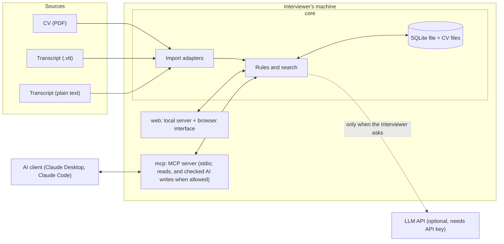
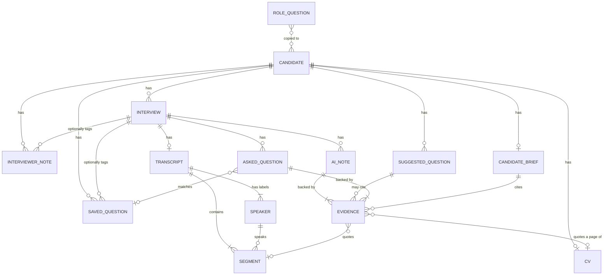

# Architecture

Status: **implemented**. This page describes the code as it is. The plan it started from is in [plan.md](plan.md); setup and an introduction to MCP are in [mcp.md](mcp.md).

Terms in capitals are defined in [GLOSSARY.md](../GLOSSARY.md). Reasons for each choice are in the [decision log](decisions.md).

## Overview

Interview Companion is one TypeScript project that runs on the Interviewer's machine. It has three parts:

- **core** holds every rule and all data access. It knows nothing about the browser or MCP.
- **web** is a local server and a browser interface. It calls core.
- **mcp** is an MCP server. It calls the same core.

A fourth folder, `src/evaluation`, holds the hand-run real-model evaluation (`npm run evaluate`, see `docs/evaluation/README.md`). It is not part of the app. It calls core only through its public interface, and, like the tests and `demo/make-cv.ts`, may use core's testing helpers to build its fictional CVs; lint enforces this.

Because web and mcp only call core, a rule such as "no AI Notes before the Speaker Mapping is confirmed" exists in one place.

## Two separate integration problems

- **Import adapters** solve "transcripts come in different formats". Each adapter turns one format into the same internal Transcript. A missing field, such as a timestamp, is stored as missing, never invented.
- **MCP** solves "an AI client wants to read this data". It has nothing to do with where a Transcript came from.

## Domain model

Notes on the model:

- A **Speaker** is a label from the file plus a role (Candidate, Interviewer, Other, or not yet assigned). The Speaker Mapping is confirmed once per Transcript.
- **Evidence** stores the exact quote and where it is: a Transcript segment, or a CV page.
- An **AI Note** has a Review State and a Stale flag. A Corrected note keeps the original AI text.
- A **Saved Question** is a copy. It does not point back to a Suggested Question that could later disappear, and a copy of a Role Question does not change when the role's list changes.

## Main flows

**Import a CV.** The PDF is saved, its text is extracted per page and indexed for search. A PDF with no text is refused with a clear message.

**Import a Transcript.** An adapter parses the file into segments and speaker labels. All speakers start unverified. The Interviewer assigns roles and confirms.

**Search.** A query runs against CV pages, Transcript segments, or both. Results are exact excerpts with their location. No match means "nothing found in the indexed sources", not "the Candidate lacks this".

**Generate AI Notes (in-app mode).** Requires an API key and a confirmed Speaker Mapping. Core sends the Transcript segments with their roles to the model and asks for statements with quotes. Core then checks each quote against the source and saves only the notes that pass, as Unreviewed.

**Suggest questions (in-app mode).** Runs only on request. Core sends the CV, earlier Transcripts, Interviewer Notes, and Saved Questions, plus an optional focus. Suggestions are stored until dismissed or regenerated. Accepting one copies it into Saved Questions.

**Find Asked Questions (in-app or MCP).** Requires a confirmed Speaker Mapping, and an API key in the app. Core sends the Transcript segments with their roles and the Candidate's Saved Questions, and asks for every question the Interviewer asked with an Answer Summary. Core keeps only the questions quoted from an Interviewer segment whose answer is quoted from Candidate segments at or after it, and replaces the Interview's earlier ones. It records which Saved Questions were checked, so one that was not matched shows as not found.

**Candidate Brief (MCP mode).** The Interviewer copies the brief command from the Workspace bar and pastes it into the AI client, which fetches the MCP `brief` prompt: steps, rules, and a fixed template. The steps depend on whether saving from the AI client is on when the prompt is fetched. On, the client reads the data, saves AI Notes for Interviews that have none, saves Suggested Questions, writes the brief in its own chat, and saves it with `save_candidate_brief`. Off, it only reads and writes the brief in the chat. Core keeps one brief per Candidate and checks each of its quotes against the CV and Transcripts every time it is read. The Workspace opens it from the bar.

**Export and import a Candidate.** Export writes one zip: the CV and each Transcript as their original files, and `candidate.json` with a format version, the list of files, and everything else about the Candidate. Import reads the zip and rebuilds the Candidate through core's own operations, in one transaction: the CV and Transcripts are read by the same code as an upload, the Speaker Mapping is confirmed again, and every AI quote is checked again. What fails is reported and not saved. A Candidate already in the app is replaced or kept next to the import only when the Interviewer chooses it.

## Rules enforced in code

| Rule | Where it is enforced |
|---|---|
| A quote must exist word for word in its source. | Core, before an AI Note or Asked Question is saved. |
| No AI Notes or Asked Questions before the Speaker Mapping is confirmed. | Core, at the start of generation. |
| Changing a Speaker Mapping marks AI Notes and Asked Questions Stale. | Core, in the mapping update. |
| AI never edits an Interviewer Note. | Core exposes no such operation to AI code. |
| Regenerating suggestions never changes Saved Questions. | Saved Questions are copies in a separate table. |
| A Suggested Question's quotes must exist word for word in the CV or a Transcript. | Core, before a suggestion is saved. |
| Replacing a CV or Transcript removes the suggestions that quote it. | The database, through a foreign key and a trigger. |
| No generation without a request. | Generation is only reachable from explicit actions. |
| The MCP server can only read, except for checked AI work the Interviewer allowed. | The MCP server gets `aiClientCore(core)`, a view that holds core's reads and only `saveAiNotesFromClient`, `saveAskedQuestionsFromClient`, `saveSuggestedQuestionsFromClient`, and `saveCandidateBriefFromClient`; all refuse while the setting is off. The first three run the same checks as in-app generation (ADR 0005). |
| A saved Candidate Brief's quotes are shown as found only when they are in this Candidate's CV or Transcripts now. | Core, every time the brief is read. |
| An imported Candidate's files and AI work pass the same checks as new ones. | Core, which rebuilds the import through its own operations. |
| Importing a Candidate already in the app never merges. | Core refuses until the Interviewer chooses Replace or Keep both. |

Model output itself is not deterministic. These checks are.

## MCP surface

Tools (read-only unless noted):

| Tool | Returns |
|---|---|
| `list_candidates` | Candidates with role and Interview count. |
| `get_candidate` | One Candidate's overview: CV status, Interviews, counts. |
| `search_evidence` | Exact excerpts from the CV, Transcripts, or both. |
| `get_interviewer_notes` | The Interviewer's notes for a Candidate. |
| `get_ai_notes` | AI Notes with Review State, Stale flag, and Evidence. |
| `get_asked_questions` | One Interview's Asked Questions with Answer Summaries, quotes, matched Saved Question, and Stale flag. |
| `get_saved_question_checks` | Where each Saved Question was asked, or that it was not found, per Interview. |
| `get_saved_questions` | The Interviewer's question list. |
| `get_transcript` | One Interview's Transcript, segment by segment, with speaker label and role. |
| `get_cv` | A Candidate's CV text, page by page. |
| `save_ai_notes` | Writes, when allowed: AI Notes the client wrote, checked and saved Unreviewed. |
| `save_asked_questions` | Writes, when allowed: one Interview's Asked Questions, checked, replacing the earlier ones. |
| `save_suggested_questions` | Writes, when allowed: Suggested Questions the client wrote, checked and saved. |
| `save_candidate_brief` | Writes, when allowed: the Candidate Brief, with its Evidence references. Replaces the earlier one. |
| `get_candidate_brief` | The saved Candidate Brief, each quote marked found or not found. |

Prompt:

| Prompt | Purpose |
|---|---|
| `brief` | The steps, rules, and template for preparing one Candidate: with saving on, write and save AI Notes, Asked Questions, Suggested Questions, and the Candidate Brief; with saving off, only read and write the brief in the chat. |

## Trade-offs we accepted

- **Keyword search only.** Simple and explainable, but a search for "caching" will not find "Redis". An AI client can run several searches to cover this.
- **Notes without an exact quote are dropped.** We lose some useful notes to keep the Evidence guarantee.
- **The Candidate Brief's statements are not verified by our code.** Only its quotes are checked, once it is saved. See [ADR 0002](adr/0002-two-ai-modes.md) and [ADR 0005](adr/0005-ai-client-saves-through-core.md).
- **One Interviewer only.** Collaboration would need a real redesign. See [ADR 0001](adr/0001-local-single-user-sqlite.md).
